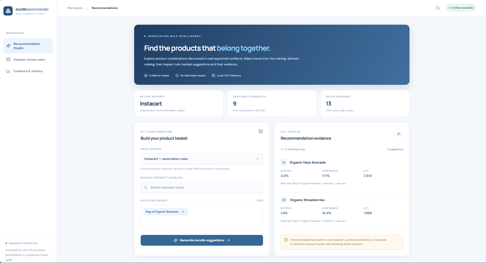
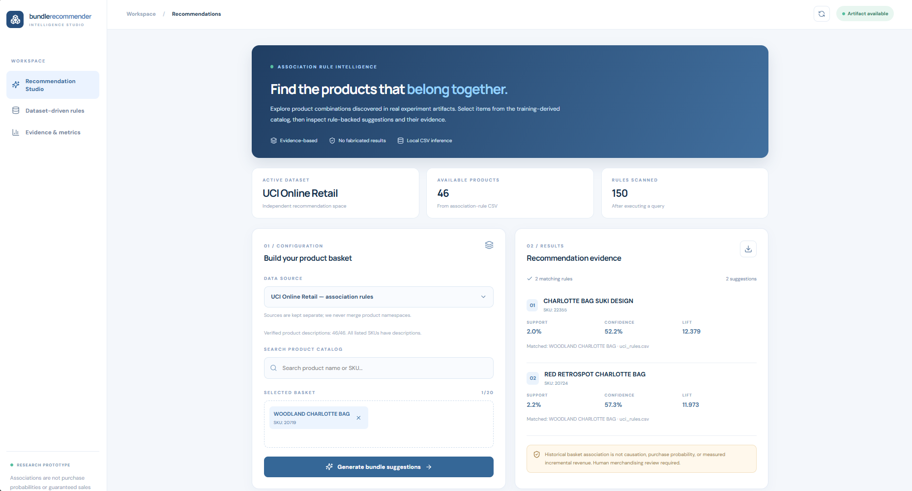
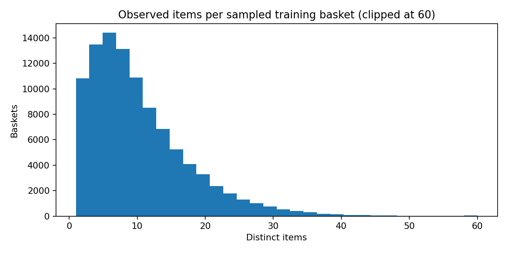
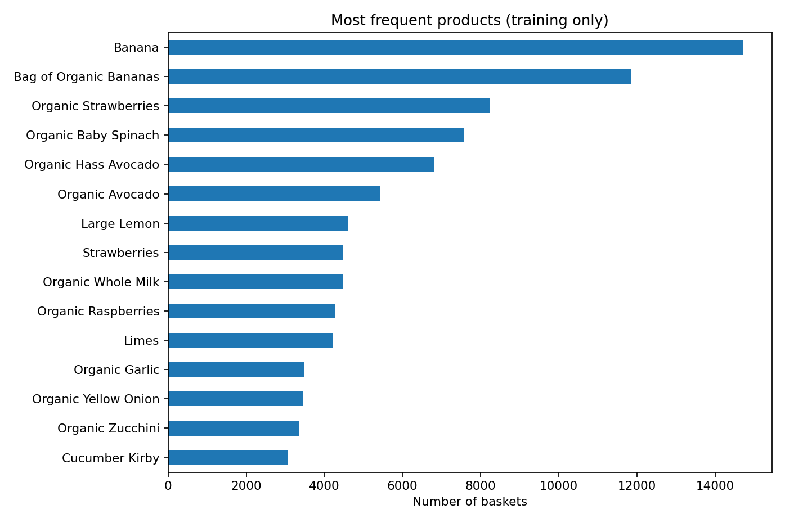
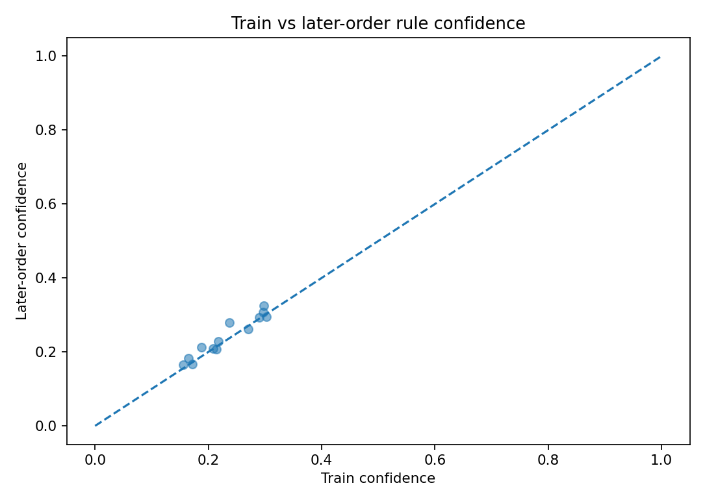
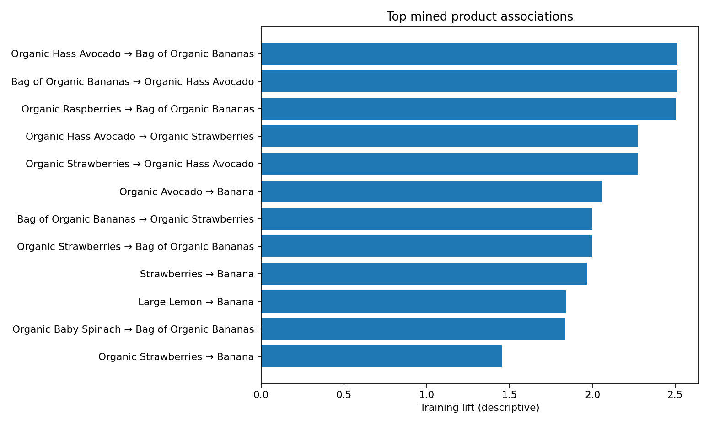

# Asset index — BundleRecommender

Assets are existing screenshots and notebook-generated research plots; avoid relabeling or fabricating metrics. **Do not assume screenshots constitute a quantitative evaluation.**

## Product demonstration screenshots

### `screenshots/new.png`

Tracked local dashboard capture. Use as a visual demonstration of the current UI at that point in development; check the actual captured dataset/selection before describing specific products in social content.

### `screenshots/new2.png`

Tracked local dashboard capture. The README pairs the two screenshots with both Instacart/UCI demos; if ordering differs in actual files, correct those captions after visually verifying the files.

## Saved research plots

| Artifact | Purpose | Caveat |
|---|---|---|
|  | Distribution of training basket sizes | Experimental subset, not full population |
|  | Product frequency in training | Does not prove sales impact |
|  | Compare association confidence between sets | Not calibrated user purchase probability |
|  | Strength of association rules | Not causal uplift |

## Asset rules

- Keep filenames and Markdown paths aligned; do not invent missing screenshots.
- Never put customer PII in screenshots.
- Re-export plots only from a reproducible notebook run and update report references.
- `diagrams/` currently has a `.gitkeep` placeholder; no architecture illustration is claimed to exist.
